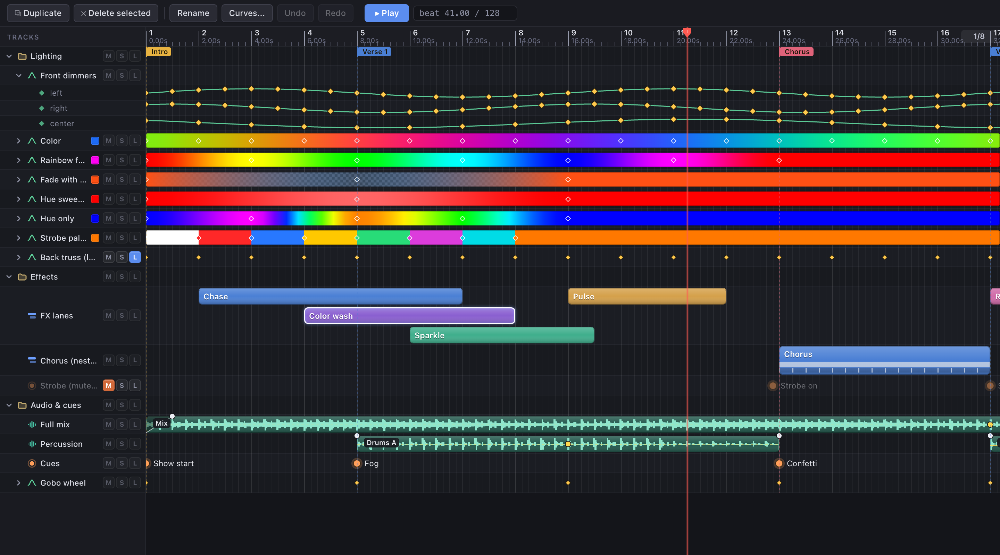
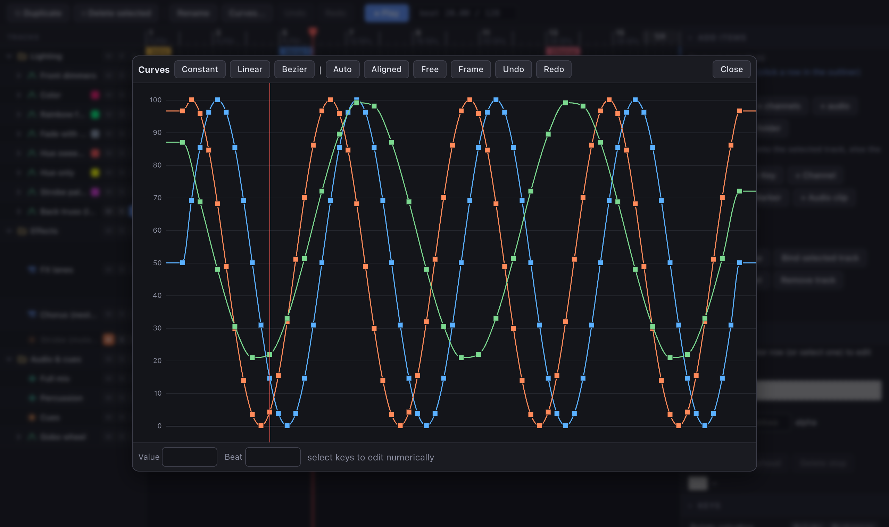
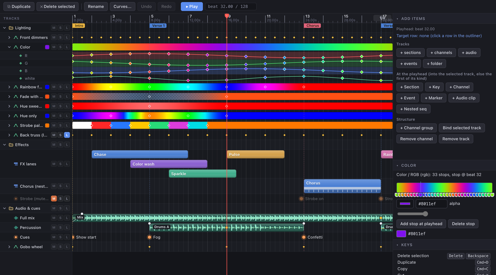
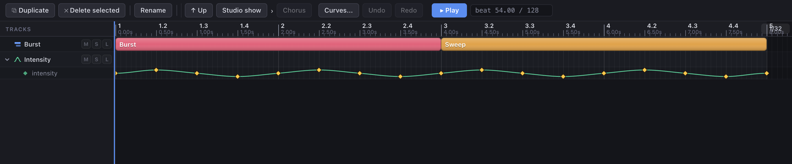
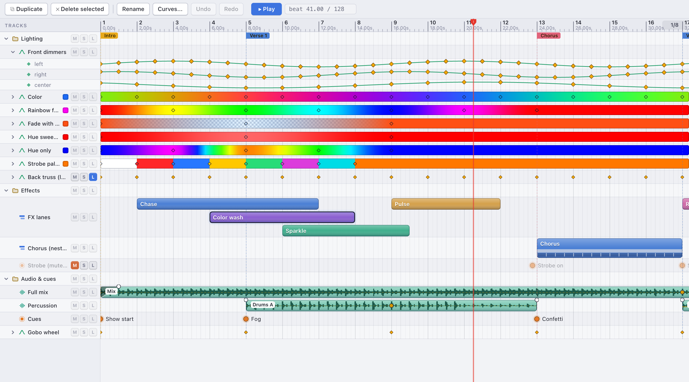

# real-timeline-editor

A timeline and sequencer editor for the web. Drop it into any page, hand it a sequence, and your users can lay out
tracks, drag clips, key values, scrub and undo, the way they would in a desktop animation or lighting tool.

- **Framework-agnostic.** Plain TypeScript drawn on canvas, with no runtime dependencies. Works with React, Vue,
  Svelte or no framework at all.
- **Fast.** 200 tracks with 2,000 keys each still drag at 60 fps.
- **Yours to drive.** Your app owns playback: the widget reads your clock, asks you to seek and reports every edit.
  It never plays audio or fires events by itself.

It is built for people making editors: light shows, animation tools, video or audio sequencers, automation timelines.
The interaction model follows Unreal Engine's Sequencer, with ideas from Blender and Ableton Live.



## Quick start

The package is not on npm yet. Install it straight from GitHub (it builds itself on install):

```bash
npm install github:v1vendi/real-timeline-editor
```

Then mount it into an element that has a size:

```ts
import { createTimeline, parseSequence, serializeSequence } from "real-timeline-editor";

let beat = 0;                                      // your transport owns the playhead

const tl = createTimeline(document.getElementById("app")!, {
  sequence: parseSequence(savedJson),              // or a Sequence object literal
  clock: { getTime: () => beat },
  onSeek: (b) => { beat = b; },                    // the user scrubbed; you decide what to do
  onChange: (seq) => save(serializeSequence(seq)), // after every edit, undo and redo
});

tl.destroy();                                      // when you are done
```

A minimal sequence looks like this:

```json
{ "version": 1, "id": "show", "name": "Show", "length": 32, "beatsPerBar": 4,
  "tempo": [{ "beat": 0, "bpm": 120 }],
  "tracks": [
    { "id": "fx", "kind": "sections", "name": "Effects",
      "sections": [{ "id": "s1", "start": 2, "length": 8, "row": 0, "label": "Chase" }] },
    { "id": "d", "kind": "channels", "name": "Dimmers",
      "channels": [{ "id": "dim", "name": "dim", "keys": [{ "beat": 0, "value": 10, "interp": "linear" }] }] }
  ],
  "markers": [{ "id": "m", "beat": 8, "label": "Drop" }],
  "library": {} }
```

## Features

**Tracks and clips.** Sections (clips), keyed channels, audio, point events and folders, with overlap lanes, a beat
grid (straight, triplet or dotted) and snapping to the grid, keys, edges, markers and the playhead. Move, trim, split,
copy, paste, duplicate, nudge and quantize, all with undo and redo. Mute, solo and lock per track.

**Keys and curves.** Constant, linear and bezier segments with auto, aligned or free tangents. Double-click a channel
and host the curve editor wherever you like; the demo puts it in a dialog.



**Color.** Group channels as RGB, RGBA, HSV or hue, and the track draws as a gradient. Each stop is edited as one color,
and you can plug in your own color picker.



**Nested sequences.** A clip can play another sequence with its own offset, scale and loop. Double-click to step
inside, and use the breadcrumbs to come back out.



**And also:** audio waveforms with fades and gain; markers, a loop or work range and ruler scrubbing; a rebindable
keymap; custom painters for sections, audio clips and keys; a read-only mode; and versioned JSON load and save.

**Themes.** Dark and light are built in, and every color, font, radius and row height can be overridden.



## Try the demos

```bash
git clone https://github.com/v1vendi/real-timeline-editor.git
cd real-timeline-editor
npm install
npm run dev
```

Then open:

- http://localhost:5173/studio.html for the full studio: toolbar, side panels, a sample light show and the curve editor.
- http://localhost:5173/ for the bare timeline. Add `?stress` for 200 tracks with 2,000 keys each.
- http://localhost:5173/widget.html for the smallest embedding example.

## Documentation

- [API reference](docs/api.md): options, methods, exports, keymap, theme, data model and edit commands.
- [Behavior guide](docs/behavior.md): how the editor behaves, gesture by gesture, and the decisions behind it.
- [Design notes](docs/design.md): what we borrowed from Sequencer, UMG, Blender and Live, and the architecture.

## Development

```bash
npm run dev     # demo server (vite)
npm run check   # type check and tests
npm run build   # library bundle and type declarations into dist/
npm run bench   # headless Chrome performance run (needs Chrome installed)
```

See [CONTRIBUTING.md](CONTRIBUTING.md) for the code layout and the few rules the code follows.

## License

MIT, see [LICENSE](LICENSE).
